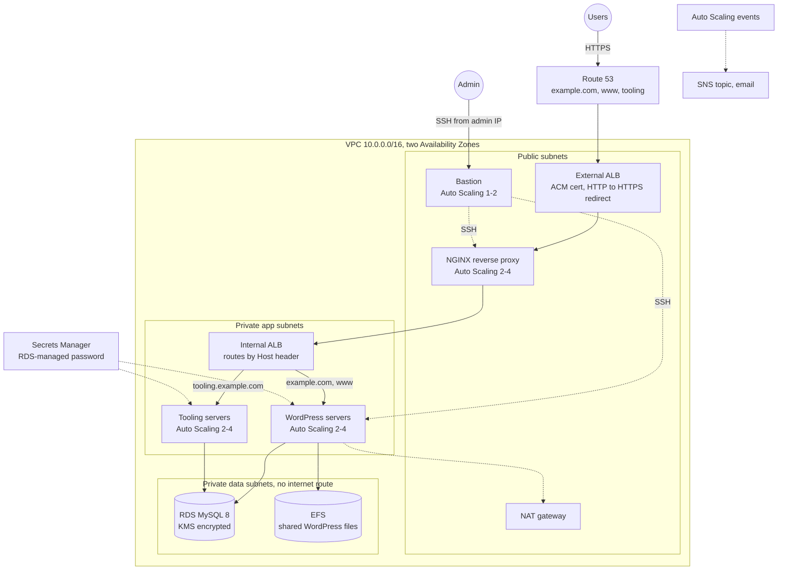

# AWS Cloud Solution for Two Company Websites with an NGINX Reverse Proxy

Terraform for a secure, highly available AWS setup hosting two company websites: a **WordPress** marketing site at `example.com` and an internal **Tooling** site at `tooling.example.com`. Users reach both through an internet-facing **Application Load Balancer**, then a fleet of **NGINX reverse proxies**, then an **internal ALB** that routes by host name to private **Auto Scaling** groups of web servers. **RDS MySQL** and **EFS** sit in isolated data subnets. Everything is encrypted with a **KMS** key, served over **ACM** TLS certificates, and published in **Route 53**.

The design comes from a hands-on project that is normally built click by click in the AWS console. This repo is the Terraform version, so the whole setup can be created and destroyed in minutes.

## Architecture



## How a request flows

1. `https://tooling.example.com` resolves through a Route 53 alias record to the external ALB.
2. The external ALB terminates TLS with the ACM wildcard certificate and forwards to a healthy NGINX instance over HTTPS.
3. NGINX proxies to the internal ALB, keeping the original `Host` header. It re-resolves the internal ALB's DNS name every 30 seconds, because ALB IP addresses change.
4. The internal ALB matches the host name `tooling.example.com` and forwards to the Tooling target group. Anything else goes to WordPress.
5. The web server reads from RDS (and, for WordPress, shared files on EFS) and the response travels back the same way.

## Security design

| Layer | Accepts traffic from | Notes |
| --- | --- | --- |
| External ALB | Internet, ports 80 and 443 | Port 80 only redirects to HTTPS; TLS 1.2/1.3 policy |
| NGINX | External ALB only, 443 | SSH only from the bastion |
| Bastion | Your admin IP only, 22 | SSM Session Manager also works with no key pair |
| Internal ALB | NGINX only, 443 | Not reachable from the internet |
| WordPress, Tooling | Internal ALB only, 443 | Private subnets; outbound through NAT |
| RDS, EFS | Web servers only, 3306 and 2049 | Data subnets have no route to the internet |

Also:
- **Least-privilege rules in both directions**: every security group rule names its source or destination group, including egress.
- **One KMS key** for EBS volumes, RDS, EFS, CloudWatch Logs and SNS, with automatic rotation. The key policy grants the Auto Scaling service-linked role access, which encrypted launch templates need.
- **No passwords in code**: RDS generates the database password and stores it in Secrets Manager. Servers fetch it at boot with their IAM role and write it to a root-only local file, never to EFS or the boot log.
- **Hardened instances**: IMDSv2 only, encrypted volumes, SSM agent, Amazon Linux 2023.
- **Audit trail**: VPC flow logs for rejected traffic, RDS error and slow-query logs exported to CloudWatch, enhanced monitoring, Auto Scaling notifications by email.
- **Policy as code**: Checkov passes, with every skipped rule and its reason in `.checkov.yaml`.

## Changes from the original manual brief

| Brief | This repo | Why |
| --- | --- | --- |
| CentOS AMIs | Amazon Linux 2023 | CentOS 7 and 8 are end of life |
| Freenom free domain | Any domain in Route 53 | Freenom no longer issues free domains |
| Bake a custom AMI per role | Stock AMI + user data | Fewer moving parts; nothing to rebuild when packages change |
| TCP target group for the bastion | No load balancer for the bastion | ALBs don't route SSH; bastion uses SSM or a key pair |
| Elastic IPs on bastions | Public IP from the Auto Scaling group | EIPs don't follow instances replaced by Auto Scaling |

## Repository layout

```
modules/network/      VPC, public/app/data subnets, NAT, route tables, flow logs
modules/asg/          launch template + Auto Scaling group + CPU scaling + SNS alerts (used 4 times)
templates/            boot scripts: nginx, bastion, web-common, wordpress, tooling
app/tooling/          the Tooling PHP site and its database schema
*.tf                  KMS, security groups, ACM + Route 53, load balancers, EFS + RDS, IAM, compute
.github/workflows/    fmt, validate, TFLint, Checkov (results in GitHub code scanning), shellcheck
```

## Run it

**You need:** an AWS account (not a work account), a domain name, Terraform 1.6 or newer, and the AWS CLI.

**Get a domain:** easiest is Route 53, **Registered domains**, **Register domain** (many domains cost under US$15 a year). Route 53 then creates the hosted zone for you; keep `create_hosted_zone = false`.

```bash
cp terraform.tfvars.example terraform.tfvars   # set domain_name, admin_cidrs, alert_email
terraform init
terraform plan
terraform apply                                # about 15-20 minutes, mostly RDS
```

Then open the `wordpress_url` output and finish the WordPress setup screen, and open `tooling_url`. If you set `alert_email`, confirm the SNS subscription email.

**Connect to a server** without SSH keys: EC2 console, select an instance, **Connect**, **Session Manager**. Or with a key pair: SSH to the bastion, then from the bastion to the private servers.

## Test the resilience

- **Kill a web server:** terminate a WordPress instance. The internal ALB stops sending it traffic, the Auto Scaling group replaces it, and an SNS email reports both events. The site stays up.
- **Watch scaling:** on a Tooling server, run a CPU stress tool (for example `stress-ng --cpu 2 --timeout 600`, if your package mirror has it) and watch the group scale out.
- **Check the routing:** `curl -sI https://tooling.<domain>` and `curl -sI https://<domain>` reach different target groups through the same NGINX fleet.

## Cost and cleanup

Roughly **US$5–6 per day** in `eu-west-1`: two load balancers, one NAT gateway, seven t3.micro instances, a db.t4g.micro database, plus the KMS key (US$1/month) and the domain. Destroy it when you finish each session:

```bash
terraform destroy
```

The KMS key is scheduled for deletion after 7 days rather than deleted at once; that's AWS's safety window.

## Next hardening steps

- Require TLS for MySQL connections and verify the RDS certificate.
- ALB access logs to S3, and AWS WAF on the external ALB.
- One NAT gateway per AZ, and RDS Multi-AZ (`db_multi_az = true`).
- Bake AMIs with Packer so instances boot faster.

## Screenshots

<!-- Add after deploying: both sites in the browser, the target groups showing healthy targets, the Auto Scaling activity after terminating an instance, the SNS email, the Checkov run. -->

## What I learned

<!-- 3-5 bullets in your own words: what you hit building it by hand, and what changed when you wrote it in Terraform. -->
